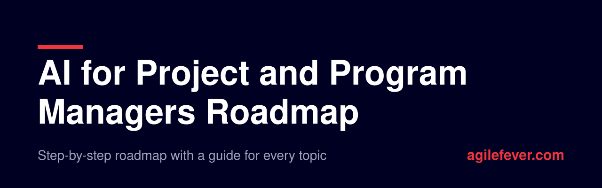

# AI for Project and Program Managers Roadmap

> AI for Project and Program Managers Roadmap - A step-by-step roadmap to automate charters, plans, meeting minutes, change control, and status reports with GenAI and AI agents, with a blog for every topic

## Table of Contents

- [Who is a Project or Program Manager who works with AI?](#who-is-a-project-or-program-manager-who-works-with-ai)
- [The Project Lifecycle with AI](#the-project-lifecycle-with-ai)
- [How to Use This Roadmap](#how-to-use-this-roadmap)
- [Step 0: Must Know](#step-0-must-know)
- [Step 1: Where AI Fits in Project and Program Work](#step-1-where-ai-fits-in-project-and-program-work)
- [Step 2: Python for AI](#step-2-python-for-ai)
- [Step 3: Your First Model Call and Prompts for PM Work](#step-3-your-first-model-call-and-prompts-for-pm-work)
- [Step 4: Project Charter and WBS Generation](#step-4-project-charter-and-wbs-generation)
- [Step 5: Reading Your Own Documents with RAG](#step-5-reading-your-own-documents-with-rag)
- [Step 6: Meeting Minutes and Change Impact Analysis](#step-6-meeting-minutes-and-change-impact-analysis)
- [Step 7: Weekly Status and EVM Reporting](#step-7-weekly-status-and-evm-reporting)
- [Step 8: AI Agents and LangGraph](#step-8-ai-agents-and-langgraph)
- [Step 9: Six Project Agents: Initiation to Reporting](#step-9-six-project-agents-initiation-to-reporting)
- [Step 10: No-Code Automation with n8n](#step-10-no-code-automation-with-n8n)
- [Step 11: Connecting Jira, Sheets, Drive, and Gmail](#step-11-connecting-jira-sheets-drive-and-gmail)
- [Step 12: Quality, Safety, and Data Protection](#step-12-quality-safety-and-data-protection)
- [Step 13: Rolling It Out in a PMO](#step-13-rolling-it-out-in-a-pmo)
- [Step 14: Show Your Skills and Plan Your Next Move](#step-14-show-your-skills-and-plan-your-next-move)
- [Learn This Roadmap with a Mentor](#learn-this-roadmap-with-a-mentor)
- [License](#license)

### Prepared and maintained by [AgileFever](https://agilefever.com)

### Follow AgileFever

- [LinkedIn](https://www.linkedin.com/company/agilefever/)
- [YouTube](https://www.youtube.com/@AgileFever)
- [X/Twitter](https://x.com/agilefever)
- [Website](https://agilefever.com)

## Learn with AgileFever

- [Generative AI and Agentic AI for Project and Program Management](https://agilefever.com/generative-ai/gen-ai-agentic-ai-for-project-and-program-management/)

---

> **Note: We keep updating this roadmap with new topics and blogs.**

---

### Who is a Project or Program Manager who works with AI?

A Project or Program Manager keeps work on scope, schedule, budget, and people. A large part of the week goes to documents and updates: charters, work breakdown structures, meeting minutes, change requests, earned value reports, and weekly status emails.

AI can take on much of that routine work. There are two levels to learn:

- **Generative AI:** a model that reads a project brief, a transcript, or a spreadsheet and produces a draft you review, such as a charter, a WBS, or an executive summary.
- **Agentic AI:** a workflow that runs on its own trigger, reads from your tools, calls a model, and sends the result on, such as a Monday EVM email or a ticket created from meeting actions.

The PM stays accountable. The aim is not to replace judgment. It is to remove the copy-and-paste so that more time goes to risks, decisions, and people. This roadmap takes us from a first API call to agents connected to real project tools.

### The Project Lifecycle with AI

This roadmap follows the project lifecycle, from initiation to reporting, and adds the technical base we need underneath.

| Phase | What you do | Steps in this roadmap |
| --- | --- | --- |
| Foundations | Learn the terms, the use cases, and the Python base | Step 0, Step 1, Step 2 |
| Generate | Call a model and produce charters and WBS | Step 3, Step 4 |
| Understand documents | Use your own plans, PDFs, and transcripts as input | Step 5, Step 6 |
| Monitor and report | Automate EVM, status, and change control | Step 7 |
| Automate | Build agents and no-code workflows | Step 8, Step 9, Step 10, Step 11 |
| Run it safely | Check quality, protect data, and roll it out | Step 12, Step 13 |
| Show it | Present working tools and plan your next move | Step 14 |

### How to Use This Roadmap

This roadmap is for working project and program managers. Some steps use Python, so we start with that.

- Follow the steps in order. Each step builds on the previous one.
- Inside each step, read the blogs in the given order. Each one covers one idea in plain words.
- Use a sample project of your own. A real brief, a real transcript, and a real status sheet teach more than a made-up one.
- Keep the API spend small. Set a usage cap on your account before you start.
- After every step, ask yourself: "Could I run this on my project next week?" If yes, move on.
- If a topic has no blog link yet, it is listed as plain text. We will add the link when the blog is published.

Let's get started.

### Step 0: Must Know

Before building anything, we must know the words that come up in every conversation about AI in projects.

- [Artificial Intelligence Terms: An A to Z AI Glossary](https://agilefever.com/artificial-intelligence-terms-ai-glossary-examples/)
- [What Is Agentic AI? A Complete Beginner's Guide](https://agilefever.com/what-is-agentic-ai/)
- [Agentic AI vs Generative AI: What Is the Difference?](https://agilefever.com/agentic-ai-vs-generative-ai/)
- [Large Language Models (LLMs): A Complete Guide](https://agilefever.com/large-language-models-llm-guide/)

Words to know: LLM, prompt, token, API, RAG, agent, and trigger.

**Check yourself:** Can you explain the difference between a script, a workflow, and an agent?

### Step 1: Where AI Fits in Project and Program Work

In this step, we look at which project tasks AI handles well today and which it does not, so we pick the right first use case and set realistic expectations with the team.

- [AI in Project Management: Tools, Risk, and Productivity](https://agilefever.com/ai-in-project-management-tools-risk-productivity/)
- [GenAI and Agentic AI Use Cases for Project and Program Managers](https://agilefever.com/genai-agentic-ai-use-cases-project-program-managers/)
- [AI Agents for Project Managers: Status Reports, Risk Logs and Schedules](https://agilefever.com/ai-agents-for-project-managers/)
- [GenAI and Agentic AI for Project and Program Management: The Complete Guide](https://agilefever.com/genai-agentic-ai-project-program-management-complete-guide/)

**Check yourself:** Can you name three tasks on your project that AI should not do alone?

### Step 2: Python for AI

The agent-building steps use Python, so we start with the basics: functions, loops, and Pandas for reading spreadsheets. You do not need to be a developer. You need to read and edit short scripts with confidence.

- [Python for AI: The Free 6-Hour Course and Who Should Take It First](https://agilefever.com/python-for-ai-free-course-who-should-take-it/)
- [Python for AI Roadmap: NumPy, Pandas, PyTorch in the Right Order](https://agilefever.com/python-for-ai-roadmap/)
- [Source Codes to Build Your First AI Assistant with Generative AI](https://agilefever.com/source-codes-build-ai-assistant-with-generative-ai/)

**Check yourself:** Can you read a short Python script that loads a spreadsheet and tell what it does?

### Step 3: Your First Model Call and Prompts for PM Work

Here we set up an API account safely, make a first call, and learn the structure of a good prompt: role, context, task, and format. We also learn to ask for structured JSON so that the output can feed the next step.

- [Prompt Engineering vs Context Engineering: What Changes in Practice](https://agilefever.com/prompt-engineering-vs-context-engineering/)
- [ChatGPT vs Grok vs Gemini vs Claude vs Perplexity](https://agilefever.com/chatgpt-vs-grok-vs-gemini-vs-claude-vs-perplexity/)
- Setting up an API key safely with a .env file (a blog is coming)
- Getting structured JSON output from a model (a blog is coming)
- Estimating the cost of a model call (a blog is coming)

**Check yourself:** Can you write a four-part prompt and get JSON back?

### Step 4: Project Charter and WBS Generation

In this step, we turn a project brief into a charter with objectives, scope, stakeholders, risks, and success criteria, and a scope document into a work breakdown structure with durations and dependency flags. We review every output as the PM.

- [Justification Definition: The Foundation of Sound Business Decisions](https://agilefever.com/project-management-business-justification/)
- [Project Cycle Management: From Basics to Advanced Guide](https://agilefever.com/project-cycle-management/)
- [Kanban for Project Management: Streamlining Workflows for Success](https://agilefever.com/kanban-for-project-management-streamlining-workflows-for-success/)
- Generating a project charter from a brief with AI (a blog is coming)
- Generating a WBS with duration and dependency flags (a blog is coming)

**Check yourself:** Can you produce a charter and a WBS from one brief and spot what the model got wrong?

### Step 5: Reading Your Own Documents with RAG

Plans, contracts, and policies live in PDFs. RAG lets a model answer from those files instead of from memory. We learn how documents are split and embedded, stored, and searched, and how to put a simple chat interface on top.

- [Large Language Models (LLMs): A Complete Guide](https://agilefever.com/large-language-models-llm-guide/)
- [From Experiment to Production: Mastering the LangChain Framework and LangSmith](https://agilefever.com/build-production-ready-llm-langchain-framework/)
- What is RAG? Embeddings, vector stores, and retrieval (a blog is coming)
- Building a chatbot over your project PDFs (a blog is coming)

**Check yourself:** Can you explain why a model should answer from your PDF and not from memory?

### Step 6: Meeting Minutes and Change Impact Analysis

Two jobs that eat time every week. We learn to turn a transcript into decisions, action items, owners, due dates, and a parking lot, including long transcripts. We also learn to assess a change request against the current plan and budget and draft the change document.

- [Effective Communication: Definition, Examples, and Benefits](https://agilefever.com/effective-communication-definition-examples-benefits/)
- [Mastering the Principles of Change Management for Streamlined Success](https://agilefever.com/mastering-the-principles-of-change-management-for-streamlined-success/)
- Extracting decisions and actions from a meeting transcript (a blog is coming)
- Change impact analysis with AI (a blog is coming)

**Check yourself:** Can you turn a transcript into actions with owners and due dates?

### Step 7: Weekly Status and EVM Reporting

Status reports and earned value reports follow a fixed pattern, which makes them a good fit for automation. We learn to turn raw metrics, risks, and updates into an executive narrative with the key message, top concerns, decisions needed, and a forward look.

- [Unlocking Business Productivity with Kanban Reporting: A Comprehensive Guide](https://agilefever.com/unlocking-business-productivity-with-kanban-reporting-a-comprehensive-guide/)
- [Kanban Metrics: Key Flow Metrics for Agile Success](https://agilefever.com/kanban-metrics-key-flow-metrics-agilefever/)
- [SAFe Agile Metrics: Measure Your SAFe Success](https://agilefever.com/safe-metrics-mastery-agile-success-guide/)
- Earned value (EVM) reports with AI narrative (a blog is coming)

**Check yourself:** Can you describe what goes into your weekly status report and which parts are automated?

### Step 8: AI Agents and LangGraph

A script runs once. An agent decides what to do next, uses tools, and keeps memory. In this step, we learn how agents are built from nodes, edges, and state, and how a graph framework such as LangGraph structures the steps.

- [Agentic AI Architecture Explained: Planner, Memory, Tools, and Reflection](https://agilefever.com/agentic-ai-architecture-planner-memory-tools-reflection/)
- [AI Agent Frameworks Compared: LangGraph, CrewAI and AutoGen](https://agilefever.com/ai-agent-frameworks-compared/)
- [Single-Agent vs Multi-Agent Systems: What Is the Difference?](https://agilefever.com/single-agent-system-vs-multi-agent-system/)
- [How To Start Learning AI Agents](https://agilefever.com/how-to-start-learning-ai-agents/)
- [How to Learn Agentic AI in 2026: A Step-by-Step Roadmap](https://agilefever.com/how-to-learn-agentic-ai/)

**Check yourself:** Can you draw an agent as a set of steps with one decision point?

### Step 9: Six Project Agents: Initiation to Reporting

Now we put it together. Each agent covers one stage of the project: initiation (brief to charter and stakeholder map), planning (recalculate the WBS when the scope sheet changes), EVM (a weekly report), meetings (minutes to tickets), scope monitoring (classify changes and raise change requests), and weekly reporting (Jira and Sheets to an email).

- [AI Agents for Project Managers: Status Reports, Risk Logs and Schedules](https://agilefever.com/ai-agents-for-project-managers/)
- [Mastering Agentic AI: Build and Deploy AI Agents Bootcamp](https://agilefever.com/agentic-ai-build-deploy-ai-agents-bootcamp/)
- Building an initiation agent (a blog is coming)
- Building a scope monitoring agent (a blog is coming)
- Building a weekly reporting agent with Jira and Sheets (a blog is coming)

**Check yourself:** Can you say which of the six agents would save you the most time this month?

### Step 10: No-Code Automation with n8n

Not every tool needs code. n8n lets us build the same flows visually: a form trigger, a model node, and an output to Docs, Sheets, or email. We learn the pattern with a charter flow and then extend it to WBS, EVM, minutes, change control, and a chat assistant.

- [Top 5 Best Kanban Tools for Product and Project Managers](https://agilefever.com/top-5-best-kanban-tools-for-product-and-project-managers/)
- [Top AI Tools Revolutionizing Every Industry in 2026](https://agilefever.com/ai-tools/)
- Your first n8n workflow with an OpenAI node (a blog is coming)
- Change control workflow in n8n (a blog is coming)
- A Telegram assistant that drafts stakeholder emails (a blog is coming)

**Check yourself:** Can you build a three-node flow that goes from a form to a document?

### Step 11: Connecting Jira, Sheets, Drive, and Gmail

Agents are only useful when they can reach your tools. In this step, we learn how tool connections work and how a standard such as MCP lets a model talk to many systems in one way.

- [Model Context Protocol (MCP) Explained for Developers](https://agilefever.com/model-context-protocol-explained/)
- [AI Agent Frameworks Compared: LangGraph, CrewAI and AutoGen](https://agilefever.com/ai-agent-frameworks-compared/)
- Connecting an agent to Jira and Google Sheets (a blog is coming)

**Check yourself:** Can you say what permissions an agent needs and what it should never have?

### Step 12: Quality, Safety, and Data Protection

A wrong number in a status report is a real problem. We learn to test AI output against known answers, to keep a person in the approval path, and to protect project data from leaks and prompt attacks.

- [How to Evaluate an LLM Application: Test Sets, Rubrics and Regression Checks](https://agilefever.com/evaluate-llm-application/)
- [Prompt Injection and Guardrails: Basic Defenses Every AI Agent Needs](https://agilefever.com/prompt-injection-guardrails/)
- Human approval steps in project agents (a blog is coming)

**Check yourself:** Can you list three tests you would run before trusting an agent's report?

### Step 13: Rolling It Out in a PMO

One PM with an agent is a start. A PMO with shared templates, a clear review step, and hybrid delivery practice is a change. This step covers how to bring teams along.

- [Agile Training for Project Managers: A PMO Plan for Hybrid Delivery](https://agilefever.com/agile-training-for-project-managers/)
- [Master the Art of Change Leadership Training: A Guide to Effective Transformation](https://agilefever.com/master-the-art-of-change-leadership-training-a-guide-to-effective-transformation/)
- [How to Run an AI Pilot Cohort Before Training the Whole Team](https://agilefever.com/how-to-run-an-ai-pilot-cohort-before-training-the-whole-team/)
- [How to Build an Internal AI Champions Program at Your Company](https://agilefever.com/internal-ai-champions-program/)
- [Measuring Training Impact: From Completion Rates to Delivery Outcomes](https://agilefever.com/measuring-ai-training-impact-delivery-outcomes/)

**Check yourself:** Can you describe a pilot for your PMO with a clear stop and go decision?

### Step 14: Show Your Skills and Plan Your Next Move

The AgileFever course has no exam. Its proof is the set of tools you build and take back to your project. We finish by planning the move from project manager to AI-augmented program lead, and by looking at how this fits with PMI and Agile credentials you may already hold.

- [Project Manager to AI-Augmented Program Lead: A Career Transition Roadmap](https://agilefever.com/project-manager-to-ai-augmented-program-lead-roadmap/)
- [Is GenAI and Agentic AI for Project and Program Management Worth It?](https://agilefever.com/is-genai-agentic-ai-for-project-program-management-worth-it/)
- [Inside AgileFever Capstones: What You Build and What It Proves](https://agilefever.com/agilefever-capstones-what-they-prove/)
- [PMP Agile and Hybrid Questions: What to Expect and How to Prepare](https://agilefever.com/pmp-agile-and-hybrid-questions/)
- [Which SAFe Certification Should a Project Manager Take First?](https://agilefever.com/safe-certification-for-project-managers/)

Interview practice: pick one report you produce every week. Explain how you would automate it, how you would check the output, and where a person still approves it.

**Check yourself:** Can you demonstrate one working tool and explain its limits?

### Learn This Roadmap with a Mentor

This roadmap follows the same path as the live Generative AI and Agentic AI for Project and Program Management course at AgileFever, where each session is a hands-on build. If you want to work through it with an instructor, see the [course page](https://agilefever.com/generative-ai/gen-ai-agentic-ai-for-project-and-program-management/).

### License

This roadmap is licensed under CC BY 4.0. You may share and adapt it with credit to AgileFever.
